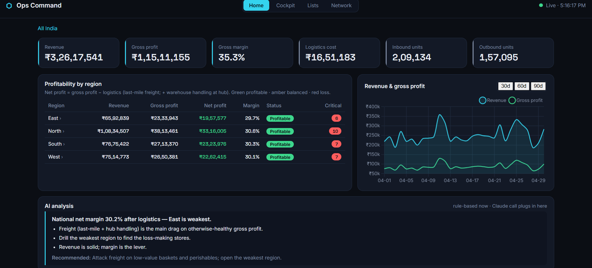
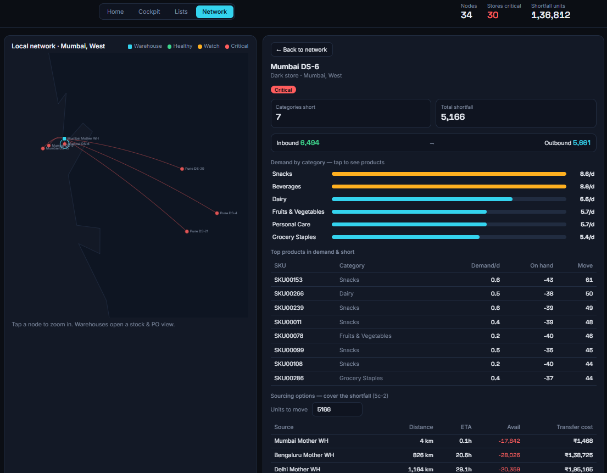
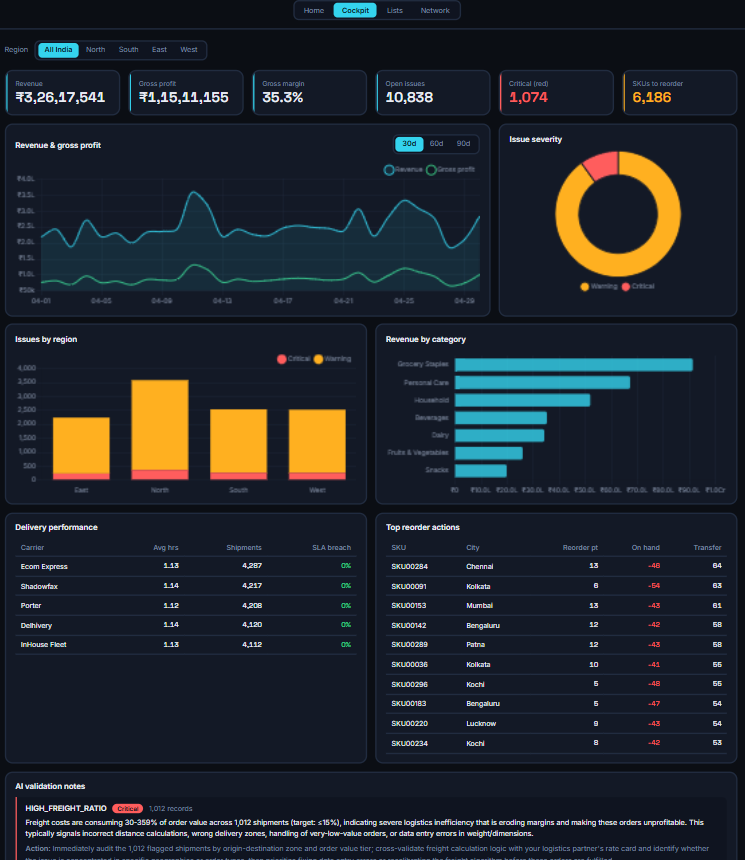
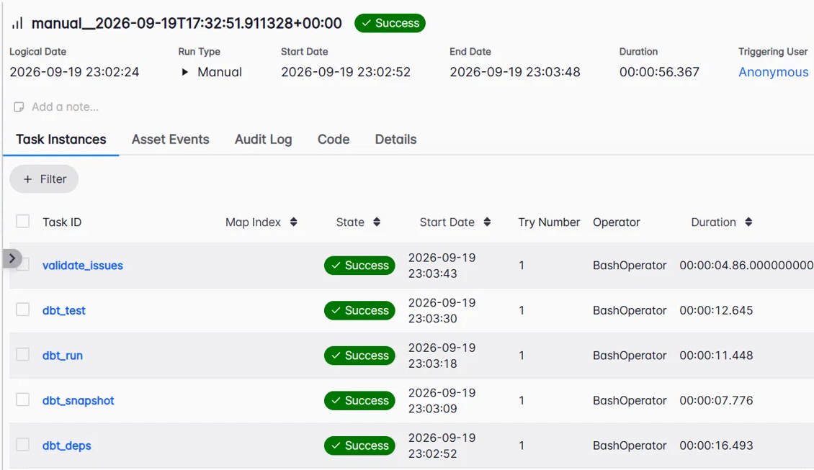
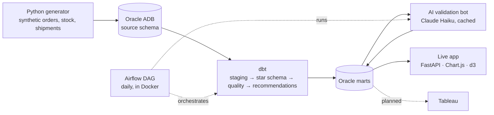

# Supply Chain Data Platform — Indian Quick-Commerce

An end-to-end data engineering project: synthetic e-commerce operations flow into **Oracle**, get modelled with **dbt**, are quality-checked with rules plus **Claude-written explanations**, run daily on **Airflow**, and are served through a **live decision-support app** that shows where the business makes or loses money, where stock is short, where it can come from, and what a transfer does to price.

**[▶ Live demo (sample data)](https://sar-26.github.io/supply-chain-de/)** · the demo pages are static copies of the real app; the real one reads live from Oracle.

| Home — profitability drill-down | Network — control tower |
|---|---|
|  |  |
| **Cockpit — charts & AI notes** | **Airflow — daily pipeline** |
|  |  |

---

## What it does

- **Simulates a business.** A Python generator produces ~21k orders (≈63k order lines), ≈66k stock movements, shipments, replenishments and purchase orders across 4 warehouses, 30 dark stores and 25 supplier sites in Indian cities, with weekend and festival demand patterns.
- **Models it properly.** dbt builds staging views, a star schema (5 fact tables, 5 dimensions, SCD Type 2 on products) and a margin chain per order line: gross → discount → net → COGS → gross profit. 20+ models and 65+ tests.
- **Checks its own data.** Four business-rule checks (negative stock, low margin, high freight ratio, delivery SLA) write ~10.8k issues into `dq_issues`, tagged RED/AMBER and sliceable by region.
- **Explains problems in plain English, cheaply.** The validation bot sends Claude one compact summary per *issue group* (not per row), about 4 calls in total, cached on a content hash so unchanged data costs nothing.
- **Recommends replenishment.** A 28-day demand baseline plus supplier lead time gives reorder points and suggested warehouse-to-store transfers (≈7k recommendations).
- **Serves a live app.** One FastAPI service, four views, all reading from Oracle (see below).

## Architecture



| Layer | Tooling |
|---|---|
| Warehouse | Oracle Autonomous Database (Always Free) |
| Transformation | dbt-core 1.10 + dbt-oracle, plus a dbt snapshot for SCD2 |
| Orchestration | Airflow via Astro CLI in Docker (dbt runs in an isolated Python 3.12 venv) |
| AI | Anthropic API (Claude Haiku 4.5) for issue explanations |
| App | FastAPI, Chart.js, d3 (India map) |
| Language | Python 3.9+, SQL |

## The daily pipeline

`scm_pipeline` (Airflow, `@daily`, one retry):

`dbt deps` → `dbt snapshot` → `dbt run --full-refresh` → `dbt test` → `validate_issues.py`

If any dbt test fails, the DAG stops before the AI step, so bad data never gets explained as if it were good.

## Data model

- **Facts:** `fact_sales` (order-line grain, carries the margin chain), `fact_inventory_movement`, `fact_shipment`, `fact_procurement`, `fact_replenishment`
- **Dimensions:** `dim_date` (weekend and festival flags), `dim_product` (SCD2), `dim_location` (warehouse / dark store / supplier site, with region), `dim_customer`, `dim_supplier`
- **Derived:** `int_daily_demand`, `recommendations`, `dq_issues`; `issue_explanations` holds the AI notes
- Surrogate keys are dbt hash keys: they are joined on, never parsed. Drill-downs use the numeric business id.

## The live app

One command serves four views on one port:

| View | Answers |
|---|---|
| **Home** | Who is profitable, balanced or losing money? Drill All India → region → warehouse/store → category → product. Net profit = gross profit − logistics; Loss < 0%, Balanced 0–10%, Profitable > 10%. |
| **Network** | Where is stock short? India map of warehouses and stores by stock health; drill into a store for category and product demand; **sourcing** ranks warehouses by distance, ETA and transfer cost; a **price-impact simulator** shows what share of a transfer's cost to pass to customers (absorb, break-even, protect ₹/unit, protect % margin). |
| **Cockpit** | Revenue and margin trend, issues by severity and region, delivery performance, top reorder actions, AI validation notes. Region filter, 30/60/90-day window. |
| **Lists** | All warehouses and dark stores, plus open and overdue purchase orders (which suppliers are late). |

## Repository layout

```
.
├── schema.sql                 # source tables only; dbt owns everything downstream
├── generate_data.py           # synthetic data generator
├── db.py                      # Oracle connection helper
├── validate_issues.py         # AI validation bot
├── app.py                     # unified app: one port, four views
├── cockpit_api.py  cockpit.html
├── home_api.py     home.html
├── lists_api.py    lists.html
├── net_api.py      network.html
├── docs/                      # static demo for GitHub Pages
└── supply_chain/
    ├── models/{staging,marts,quality}/
    ├── snapshots/
    └── airflow-scm/           # Airflow project (Dockerfile, dags/, include/)
```

## Run it yourself

Prerequisites: an Oracle Autonomous Database (Always Free works), Python 3.9+, and Docker plus the Astro CLI for Airflow.

```bash
python -m venv venv && source venv/bin/activate        # Windows: venv\Scripts\activate
pip install -r requirements.txt
pip install fastapi uvicorn anthropic
cp .env.example .env                                   # fill in your own values

# 1. create source tables (run schema.sql in Database Actions), then load data
python generate_data.py

# 2. transform and test
cd supply_chain && dbt deps && dbt snapshot && dbt run && dbt test && cd ..

# 3. AI validation notes (needs ANTHROPIC_API_KEY in .env)
python validate_issues.py

# 4. the app
uvicorn app:app --port 8000        # Home at /, plus /cockpit /lists /network

# 5. Airflow (optional)
cd supply_chain/airflow-scm && cp .env.example .env && astro dev start   # UI on :8080
```

dbt connects over wallet-free TLS. In `~/.dbt/profiles.yml` use `protocol: tcps`, your `host`, `service` and `port: 1521`, and in the database's network settings allow your IP and set mutual TLS to *not required*. Never commit `.env`, wallet files or `profiles.yml`.

## Engineering notes

Things that went wrong and what they taught me:

- **dbt-oracle in thin mode can't do wallet (mTLS) connections** reliably. Switching to wallet-free TLS plus an IP access-control list fixed it.
- **Python 3.14 broke dbt 1.10** (a `mashumaro` import error). The Airflow image is pinned to a Python 3.12 variant and dbt runs in its own virtualenv.
- **Oracle `ORA-00932` from dbt-built tables.** Money columns materialised as `BINARY_DOUBLE` and surrogate keys as `RAW`. Fix: `CAST AS NUMBER` on aggregates, and never convert surrogate keys, only join on them.
- **Secrets hygiene.** GitHub push protection blocked a commit containing an API key. I rotated the key, rebuilt the history and added leak checks to the commit routine.
- **Debugging approach.** The blank-page bugs ended when each endpoint surfaced its real error instead of a generic 500.

## Known limitations

- Data is synthetic, and the generator doesn't enforce stock availability, so most stores run negative and almost every SKU flags for reorder. The logic is visibly firing, but the balance isn't realistic.
- "Logistics" is last-mile freight. The warehouse-to-store transfer cost in the simulator (₹800 + ₹12/km + ₹0.03/unit/km) and the warehouse handling cost (₹2/unit) are stated assumptions.
- The generator caps delivery at 2 hours, so SLA breaches show 0%.
- The Home page's "AI analysis" panel is rule-based; the live Claude integration today is the validation bot.
- Forecasting is a baseline moving average.
- Mart money columns are `BINARY_DOUBLE`; the app casts them. The proper fix, casting inside dbt, is planned.

## Roadmap

- [x] Phases 0–4: design, generator, dbt star schema, data quality + AI validation, Airflow, forecast + recommendations
- [x] Phase 5A: unified live app (Home, Cockpit, Lists, Network)
- [ ] Phase 5B: Tableau dashboards, published by Airflow as a Hyper extract, with a filter-aware Claude insight extension
- [ ] Phase 6: CI/CD with GitHub Actions (dbt parse and tests, app import smoke test), plus an incremental data-generation task in Airflow so the app visibly moves
- [ ] Forecasting upgrade (Prophet, statistical safety stock) and a Claude-written Home briefing

---

Built by Sar · [github.com/sar-26](https://github.com/sar-26)
